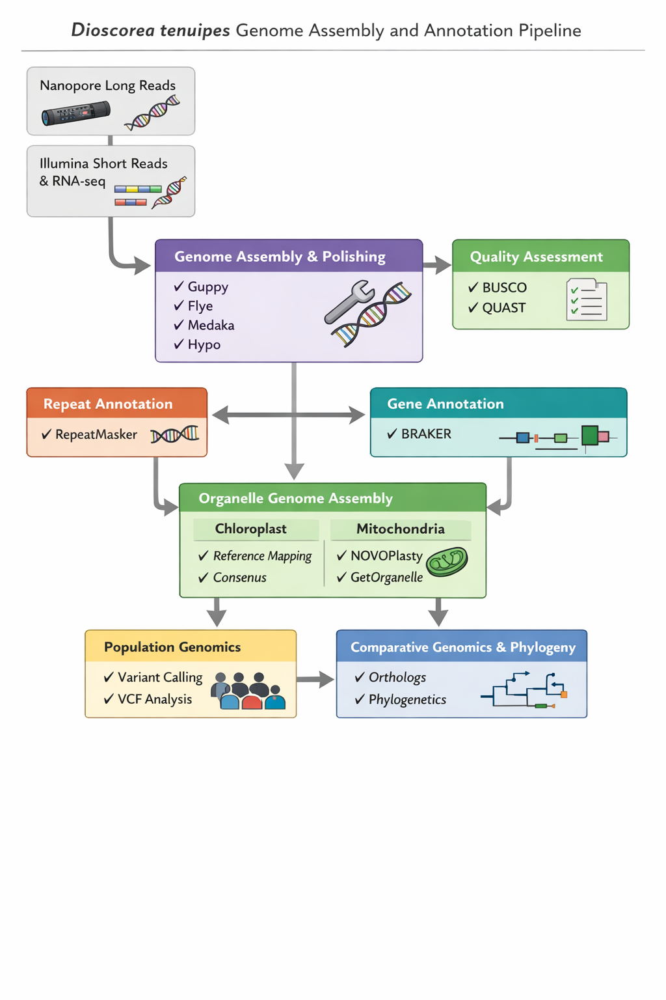

# Dioscorea tenuipes Genome Assembly and Annotation Pipeline



This repository contains scripts used to assemble and annotate the genome of *Dioscorea tenuipes* using **Nanopore long reads, Illumina short reads, and RNA-seq data**.

The workflow includes:

- Genome assembly
- Assembly polishing
- Assembly quality assessment
- Repeat annotation
- Gene annotation using RNA-seq
- Chloroplast genome reconstruction
- Mitochondrial genome reconstruction
- Population genomics
- Comparative genomics and phylogenetic analyses

The scripts were originally designed for execution on a **high-performance computing (HPC) environment**, but they can be adapted for other systems.

---

# Project Overview

The goal of this project is to generate genomic resources for *Dioscorea tenuipes* and support downstream evolutionary and comparative genomic analyses.

Major analysis components include:

- Nuclear genome assembly
- Genome polishing
- Genome completeness assessment
- Repeat annotation
- Gene structure annotation
- Organelle genome reconstruction
- Population genomics
- Comparative genomics
- Phylogenetic analysis

---

# Workflow Overview

The pipeline integrates **long-read sequencing, short-read sequencing, and transcriptomic data** to produce a high-quality genome assembly and annotation, followed by downstream population and comparative analyses.

## 1. Genome Assembly

Nanopore long reads are used to assemble the genome.

Main steps:

- Basecalling using **Guppy**
- Genome assembly using **Flye**

Scripts:

- `01_guppy_basecalling.sh`
- `02_combine_pass_reads.sh`
- `03_flye_assembly.sh`

---

## 2. Genome Polishing

Assembly polishing improves base accuracy using both long and short reads.

Tools:

- **Medaka**
- **Hypo**

Scripts:

- `04_medaka_polish.sh`
- `06_map_reads_for_hypo.sh`
- `07_hypo_polish.sh`

---

## 3. Assembly Quality Assessment

Genome assembly quality is evaluated using:

- **BUSCO**
- **QUAST**

Scripts:

- `08_busco_assessment.sh`
- `09_quast_assessment.sh`

---

## 4. Repeat Annotation

Repetitive elements are identified and masked.

Tool:

- **RepeatMasker**

Script:

- `10_te_repeatmasker.sh`

---

## 5. RNA-seq Processing

RNA-seq data are used to support gene annotation.

Tools:

- **FastQC**
- **Trimmomatic**
- **HISAT2**
- **StringTie**

Scripts:

- `11_rnaseq_fastqc_raw.sh`
- `12_rnaseq_trim_fastqc.sh`
- `13_rnaseq_align_hisat2.sh`
- `14_stringtie_transcripts.sh`

---

## 6. Gene Annotation

Gene structures are predicted using **BRAKER**, integrating RNA-seq evidence.

Script:

- `15_braker_annotation.sh`

---

## 7. Organelle Genome Reconstruction

Organelle genomes are reconstructed using multiple methods.

### Chloroplast

Reference-guided extraction:

- `16_cp_align_to_reference.sh`
- `17_cp_consensus_from_bam.sh`

### Mitochondria

De novo assembly approaches:

- `18_novoplasty_chloroplast.sh`
- `19_novoplasty_mitochondria.sh`
- `20_getorganelle_mitochondria.sh`

---

## 8. Population Genomics

This repository also includes downstream population genomic analyses based on Illumina resequencing data.

### 8.1 Variant calling and joint genotyping

The population variant-calling workflow is based on **BWA**, **SAMtools**, and **GATK**.

Main steps include:

1. Mapping trimmed paired-end reads to the *D. tenuipes* reference genome using **BWA-MEM**
2. Sorting and indexing BAM files using **SAMtools**
3. Marking duplicates using **GATK MarkDuplicates**
4. Generating per-sample GVCFs using **GATK HaplotypeCaller**
5. Importing GVCFs into **GenomicsDB**
6. Joint genotyping using **GATK GenotypeGVCFs**
7. Merging batch VCFs
8. Filtering variants using **GATK VariantFiltration**
9. Selecting high-quality biallelic SNPs using **GATK SelectVariants**

The resulting filtered SNP set is used for downstream structure and phylogenetic analyses.

### 8.2 Population structure analysis

Population structure is analyzed using **PLINK** and **ADMIXTURE**.

Main steps include:

1. Converting the filtered VCF to PLINK format
2. Updating chromosome labels based on contig-to-reference mapping
3. LD pruning with PLINK
4. Running PCA
5. Running ADMIXTURE across multiple K values
6. Comparing cross-validation errors to identify the best-supported K

### 8.3 Phylogenetic analysis from SNP data

For phylogenetic reconstruction from population SNPs, the workflow includes:

1. LD pruning using **PLINK**
2. Converting pruned SNP data from VCF to PHYLIP format using **vcf2phylip**
3. Running **RAxML** to infer phylogenetic relationships among samples

### 8.4 Contig-to-chromosome projection

Historical script 22 changes BIM chromosome labels without correctly transforming positions or orientation. Those labels are not validated chromosome coordinates. Keep original contig coordinates for current QC; use a validated AGP-based transformation, including reverse-strand alleles, when preparing Kita1 scaffold-coordinate variants.

Population analysis tools used:

- **BWA**
- **SAMtools**
- **GATK**
- **VCFtools**
- **PLINK**
- **ADMIXTURE**
- **minimap2**
- **vcf2phylip**
- **RAxML**

---

## 9. Reference-Guided Scaffolding, Annotation Review and Population Analysis

These scripts were written during a 2026 audit of the historical outputs. Several record known limitations; read the notes before reusing them.

### 9.1 Candidate scaffolds (scripts 23, 25, 26)

`scripts/23_ragtag_scaffolding.sh` records reference-guided ordering and orientation against the *D. tokoro* Kita1 assembly (Kudoh et al. 2026). `scripts/26_chromosome_correspondence.sh` summarizes Kita1/Waka1 reference alignments. Neither establishes validated chromosome structure: the Kita1- and Waka1-guided runs assign some contigs to different chromosomes. Report scaffold continuity separately from contig continuity.

### 9.2 Repeat annotation (script 27)

`scripts/27_repeatmodeler_softmask.sh` records the planned RepeatModeler/RepeatMasker workflow. Its parallel settings need correction before use: RepeatMasker `-pa` counts parallel batches, and with RMBlast each batch uses four cores.

### 9.3 RNA evidence from complete transcript structures (script 29)

`scripts/29_prepare_rna_evidence.py` derives intron evidence from the complete StringTie GTF, keeping transcript provenance, and quarantines malformed transcripts whole. The output is structural evidence, not raw-read validation or a drop-in BRAKER-ETP input. Script 24's reconstruction from incomplete hints is unsuitable for annotation. RagTag 2.1.0 assigns '+' to unknown-strand features on reverse components; script 29 preserves unknown strand.

### 9.4 Annotation and scaffolding audit (script 28)

`scripts/28_audit_annotation_and_scaffolding.py` rechecks preserved BUSCO tables, AGP assignments and hint lifts without launching pipelines (Python 3.9+).

### 9.5 Population input audit (scripts 30–31)

- `scripts/30_audit_population_vcf.py`: bounded exact-allele VCF comparison and sample QC.
- `scripts/lib/compare_population_genotypes.c`: complete genotype comparison via HTSlib.
- `scripts/31_diagnose_population_samples.py`: reproducible genomic-window diagnostics.

See the [runbook](docs/POPULATION_AUDIT_RUNBOOK.md). Script 22's chromosome relabeling (section 8.4) is not used by any later analysis.

### 9.6 Population structure, relationships and sample influence (scripts 32–55)

Masked genotype panels, then:

- PCA, ADMIXTURE and Weir–Cockerham FST (32–34),
- individual networks, NJ trees and relatedness (44–49),
- leave-one-out and candidate-relative influence on PCA and FST (53–55).

Original contig coordinates are kept throughout. Exact filters and their limitations are in [docs/RUN_POPULATION_ANALYSIS.md](docs/RUN_POPULATION_ANALYSIS.md). These steps are automated by the Snakemake workflow below.

## 10. Comparative Genomics and Phylogeny

Comparative analyses are performed to investigate evolutionary relationships among *Dioscorea* species.

Main steps include:

- Ortholog detection
- Single-copy ortholog extraction
- Multiple sequence alignment
- Phylogenetic tree reconstruction

---

# Repository Structure

```text
Snakefile     Snakemake entry point (wraps scripts/, see workflow/README.md)
scripts/      Numbered pipeline scripts
config/       Snakemake configuration (template, conda overlay, assembly module)
workflow/     Snakemake rules, conda envs, default profile, dry-run test
tests/        Unit tests for the population, relationship and plastome code
docs/         Runbooks and workflow verification records
figures/      Figures used in the README
```

---

# Software Requirements

Major software used in this pipeline includes:

- Guppy
- Flye
- Medaka
- FastQC
- Trimmomatic
- Minimap2
- Samtools
- BWA
- Hypo
- BUSCO
- QUAST
- RepeatMasker
- HISAT2
- StringTie
- BRAKER
- BCFtools
- GATK
- VCFtools
- PLINK
- ADMIXTURE
- vcf2phylip
- RAxML
- GetOrganelle
- NOVOPlasty

See:

- `environment.yml`
- `software_versions.md`

for detailed dependency information.

---

# Input Data

Required input data may include:

- Nanopore long reads
- Illumina paired-end reads
- RNA-seq reads
- Reference nuclear genome
- Reference chloroplast genome (optional)
- Reference mitochondrial genome (optional)
- Population resequencing data for multiple samples

Large datasets are **not included in this repository**.

---

# Reproducibility

Most scripts were originally written for **HPC cluster environments**.

Before running the pipeline, users should:

- adjust file paths
- verify software installations
- configure resource settings such as threads and memory
- check sample naming consistency across analysis steps

## Snakemake workflow

The population analyses used in the manuscript (scripts 32–34, 44–49, 53–55) can be run as one Snakemake workflow. The historical assembly and annotation scripts 01–15 are available as an optional template module.

```bash
snakemake -n                                    # dry run
snakemake --profile workflow/profiles/default   # run
```

The workflow always writes to a new `results_dir` and refuses to overwrite completed analysis directories. An end-to-end run reproduced the original genotype panels, PCA, ADMIXTURE and FST byte for byte ([docs/WORKFLOW_VERIFICATION.md](docs/WORKFLOW_VERIFICATION.md)). See [workflow/README.md](workflow/README.md) for the rule map, safety design and environments. GitHub Actions (`.github/workflows/ci.yml`) runs the unit tests and the dry run on every push.

---

# Author

**Ningyu Sun**  
Kyoto University

---

# License

This project is released under the **MIT License**.
