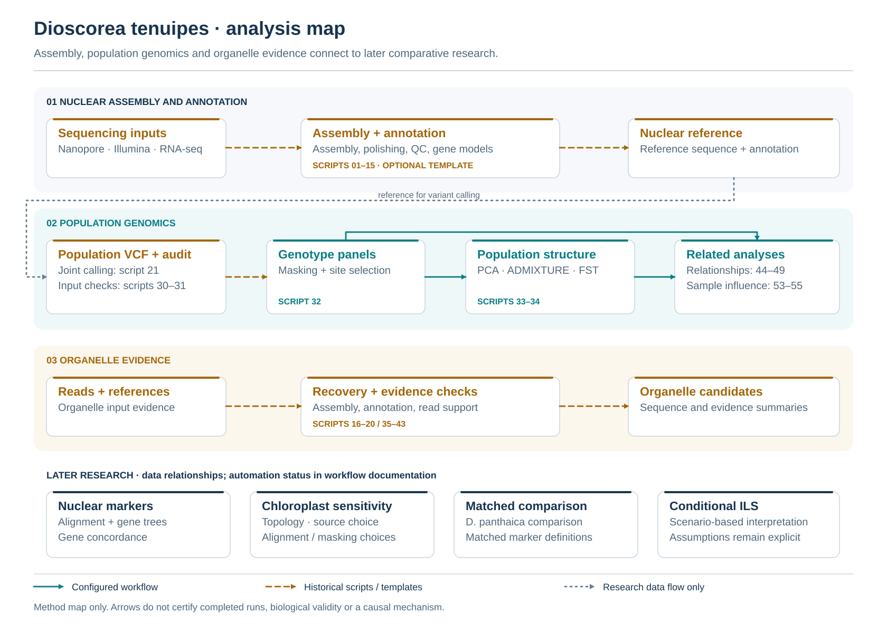
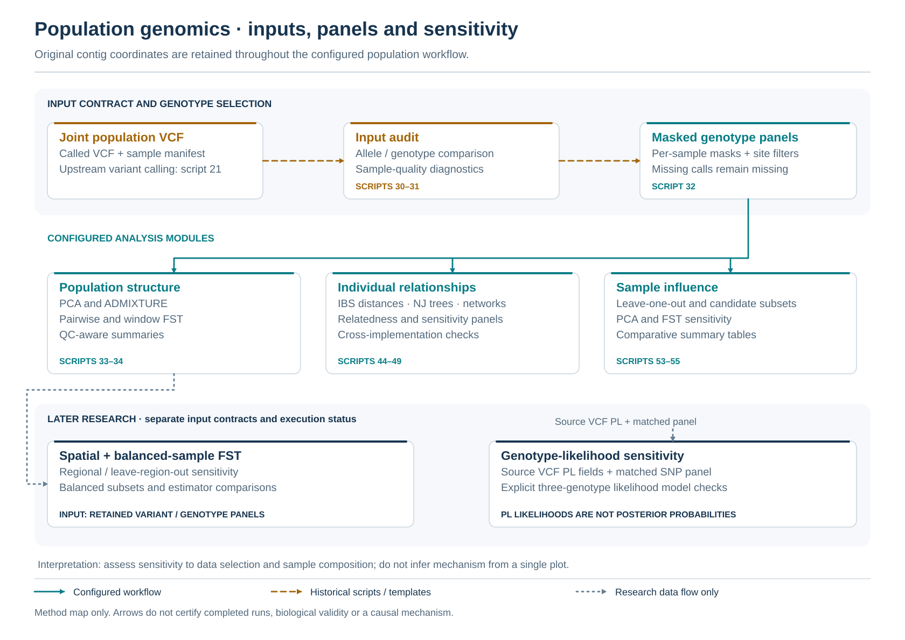
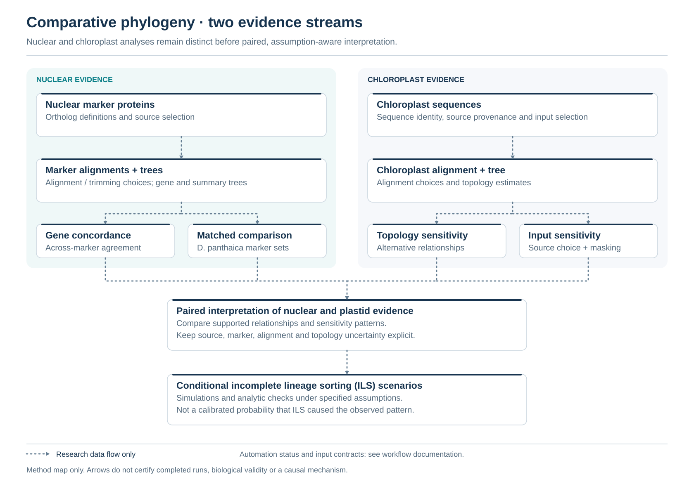

# Dioscorea tenuipes · genome and comparative analysis

Code for nuclear genome assembly and annotation, population genomics, organelle validation, and subsequent nuclear–chloroplast comparative analyses.

**[QC summary](#quality-control)** · **[Every script and its purpose](docs/SCRIPT_CATALOG.md)** · **[Software & package versions](software_versions.md)** · **[Snakemake workflows](workflow/README.md)** · **[Project index](PROJECT_INDEX.md)**



## Quality control

The following summarizes preserved QC results from September–October 2026. The [QC snapshot](docs/provenance/qc_summary.json) records exact values, denominators, thresholds and source-record checksums. Full input and result archives are retained separately and are not included in this repository. No analysis was rerun for this documentation update.

### Reference assembly and reads

| Metric | Current h2 reference / recorded input |
|---|---:|
| Assembled sequence | 403,772,333 bp |
| Contigs | 9,423 |
| Contig N50 / N90 | 103,611 / 19,037 bp |
| Longest contig | 2,824,417 bp |
| Filtered Nanopore input | 862,169 reads; 19.24 Gb; read N50 36,881 bp |
| Reference Illumina input | 23.32 Gb; reported read count combines R1 and R2 |

Assembly statistics refer to the original h2 contigs, which also provide the population-analysis coordinates. N50 describes sequence continuity; it does not measure consensus accuracy or genome completeness. Reference-guided scaffold lengths are evaluated separately.

### Population filters and sensitivity

The source dataset contains **16 study individuals and three public comparators**. Two study individuals were excluded for very low genotype support and exceptional heterozygosity, leaving **14 study individuals** in the main analysis. The supplementary panel contains these 14 plus the three public comparators.

Passing biallelic SNPs are retained. Low-quality or partial genotypes, including calls with missing required quality values, are masked as missing. Allele counts are recalculated after masking and sample selection. DP is read depth; GQ is genotype quality; MAC is minor allele count.

| Panel — same 14 study individuals | Genotype thresholds | Maximum missing calls per site | Retained SNPs | LD-pruned PCA SNPs |
|---|---|---:|---:|---:|
| Main | DP 5–100; GQ ≥20 | 10% | 5,564,311 | 37,566 |
| Strict | DP 8–60; GQ ≥30 | 10% | 3,969,581 | 32,805 |
| Complete-call | DP 5–100; GQ ≥20 | 0% | 3,367,199 | 34,908 |

All three site panels require **MAC ≥1**. The 10% rule is per site, permitting at most one missing individual among 14. PCA additionally uses **MAC ≥2**, 1-kb within-contig spacing and PLINK `--indep-pairwise 50kb 1 0.2` to reduce linkage disequilibrium (LD) within contigs. See [filtering](scripts/32_filter_population_variants.py) and [PCA preparation](scripts/33_run_population_structure.py).

Compared with the main analysis, first-two-PC pairwise-distance correlations are **0.99984** for stricter filtering, **0.99993** for complete calls and **0.99949** for the separate **7,829-SNP, one-per-contig** panel. These describe consistency on the same 14 individuals under the tested choices, rather than independent validation or genotype accuracy.

### Nuclear-marker and plastid checks

- **Nuclear markers:** the 173-locus, 12-taxon panel uses BUSCO complete single-copy candidates, proteins ≥50 amino acids with ≥95% canonical residues and no internal stops, ≥80% taxon/column occupancy, ≥50 retained alignment columns and ≥50% coverage for each present sequence. The [matrix builder](scripts/research/nuclear/build_busco_matrices.py) also records the `2661at3193` exclusion.
- **Protein–genome correspondence:** extraction and translation of mapped CDS reproduced **149 of 173** marker proteins exactly. All **24 non-exact or partial matches were retained**. This is an internal sequence-correspondence check at aligner-selected coordinates, not independent read validation or a genome-wide accuracy estimate. See the [CDS audit implementation](scripts/research/nuclear/historical/genomic_cds_translation.py).
- **Plastid checks:** orientation and inverted-repeat normalization, conservative read-backed recovery for selected samples, and alignment, model, masking and source-sensitivity comparisons. Read-backed checks apply to the selected recovered samples, not every public plastome. See the [chloroplast script catalogue](docs/SCRIPT_CATALOG.md#chloroplast-comparison-and-topology-controls).

## Scripts by purpose

| Analysis | Scripts | What they do |
|---|---|---|
| Assembly and polishing | [01–09](docs/SCRIPT_CATALOG.md#assembly-annotation-organelles-and-population-analysis) | Basecall reads, assemble contigs, polish the sequence, and measure assembly quality. |
| Annotation and scaffold review | [10–15, 23–29](docs/SCRIPT_CATALOG.md#assembly-annotation-organelles-and-population-analysis) | Process RNA-seq, annotate genes/repeats, and audit reference-guided scaffolds and transcript evidence. |
| Population variants and structure | [21–22, 30–34](docs/SCRIPT_CATALOG.md#assembly-annotation-organelles-and-population-analysis) | Call/audit variants, mask genotypes, construct panels, and estimate PCA, ADMIXTURE and FST. |
| Individual relationships | [44–49](docs/SCRIPT_CATALOG.md#assembly-annotation-organelles-and-population-analysis) | Estimate relatedness, unrooted trees and networks; cross-check the implementations. |
| Sample and filter sensitivity | [50–55](docs/SCRIPT_CATALOG.md#assembly-annotation-organelles-and-population-analysis), [research/population](docs/SCRIPT_CATALOG.md#later-population-sensitivity) | Check public-read processing, sample influence, allele balance, genomic regions, balanced sampling and genotype likelihoods. |
| Organelle sequence evidence | [16–20, 35–43](docs/SCRIPT_CATALOG.md#assembly-annotation-organelles-and-population-analysis) | Recover candidate sequences, annotate the plastome, and check sequence differences against reads. |
| Nuclear markers and phylogeny | [research/nuclear](docs/SCRIPT_CATALOG.md#nuclear-markers-and-gene-concordance) | Audit marker identity, build amino-acid matrices, estimate gene trees and count concordant/alternative relationships. |
| Chloroplast comparisons | [research/chloroplast](docs/SCRIPT_CATALOG.md#chloroplast-comparison-and-topology-controls) | Prepare expanded plastome panels and compare topology, source choice and alignment/masking controls. |
| Matched *D. panthaica* comparisons | [research/panthaica](docs/SCRIPT_CATALOG.md#d-panthaica-matched-marker-comparison) | Compare matched marker sets with and without the additional taxon and test locus/site sensitivity. |
| Nuclear lineage-sorting models | [research/nuclear_ils](docs/SCRIPT_CATALOG.md#nuclear-multispecies-coalescent-simulations) | Generate conditional nuclear gene histories and re-estimate their quartet relationships. |
| Chloroplast lineage-sorting models | [research/chloroplast_ils](docs/SCRIPT_CATALOG.md#conditional-chloroplast-genealogies-and-distance-scenarios) | Simulate linked plastid genealogies and sequence-distance scenarios, then check them analytically. |

The catalogue gives a separate purpose for **each script**, including helpers and configurable historical stages. [The later-analysis source map](workflow/research/SOURCE_MAP.csv) records source stages, hashes and portability changes.

## Population workflow



The root [Snakefile](Snakefile) connects population filtering/structure (32–34), relationships (44–49) and sample influence (53–55). Assembly/annotation (01–15) is an optional template. [The rule map](workflow/README.md) lists the precise coverage.

```bash
# Plan the existing population workflow; no jobs run with -n.
snakemake all -n --cores 4 --configfile config/config.yaml

# Plan later analyses from separately prepared inputs.
snakemake research_all -n --cores 4 \
  --configfile config/config.yaml config/research.yaml
```

Paths in the configuration files are examples. Later targets cover locus trees/concordance, regional and balanced-sample FST, and conditional chloroplast simulation/validation. The bounded chloroplast tree driver is a separate optional target. The [22 configured historical stages](workflow/portable/README.md) add explicit preparation/comparison chains and safe preflight. See [later workflow contracts](workflow/research/README.md) for commands and boundaries.

## Comparative analyses



Nuclear and chloroplast relationships are evaluated separately. Conditional simulations describe outcomes under stated model assumptions; they do not give a calibrated probability of hybridization or prove a single evolutionary mechanism.

## Versions and verification

[software_versions.md](software_versions.md) records the software and package versions actually found in run logs and environment receipts, including stage-specific differences. [The evidence table](docs/provenance/software_versions.tsv) supplies version excerpts and source hashes. Environment templates and this release's code-check environment are identified separately.

The [2026-09-24 verification record](docs/WORKFLOW_VERIFICATION.md) describes the earlier population replay. [The source release checks](docs/PUBLIC_CODE_RELEASE_2026-10-16.md) and [historical-script portability checks](docs/PORTABLE_SCRIPTS_2026-10-16.md) cover code, small artificial tests, documentation and dry-run planning. No research analysis was rerun for this update.

A few older scripts are retained for inspection: **22** relabels chromosomes without a full coordinate transformation; **24** reconstructs incomplete hints and is unsuitable for annotation; **27** is a repeat-analysis template whose resource settings need review. Current contig-coordinate population analyses use **32–55**; transcript-structure evidence uses **29**. Reference-guided scaffolds remain candidate structures. Mitochondrial assembly attempts do not constitute a complete mitochondrial reference.

## Repository layout

```text
scripts/                 Numbered scripts and shared helpers
scripts/research/        Later scientific scripts, grouped by purpose
Snakefile                Snakemake entry point
config/                  Population, assembly and later-analysis configuration
workflow/                Rules, environments, contracts and dry-run checks
docs/SCRIPT_CATALOG.md   Purpose of every script
docs/figures/            Three SVG diagrams and their editable generator
software_versions.md    Stage-specific software and package versions
PROJECT_INDEX.md         Current release state and history
```

Large sequencing data and manuscript drafts are not included in this repository. Code is released under the [MIT License](LICENSE).
